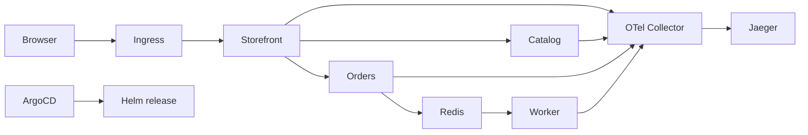

# Resilient Commerce

A resume-ready monorepo: a small shop (Next.js storefront + Python services) on local Kubernetes, with self-healing, autoscaling, traces, GitOps, GitHub Actions, and optional AWS Terraform.

The shop is only large enough to deploy, break, and scale. **The DevOps platform is the project.**

Reviewers need Linux (or WSL2), Docker, kind, kubectl, and helm — **not** an AWS account. AWS is a separate Terraform path with a cost warning (EKS control plane is billed even when idle). See [docs/aws.md](docs/aws.md).

## Architecture



## One-command start (kind)

```bash
./scripts/bootstrap.sh
```

Then add `127.0.0.1 shop.local` and `127.0.0.1 jaeger.local` to `/etc/hosts`.

| URL | What |
|-----|------|
| http://shop.local | Storefront |
| http://jaeger.local | Traces |

Tear down: `./scripts/teardown.sh`. Makefile targets: `make bootstrap`, `make teardown`, `make demo-heal`, `make demo-scale`.

Kind images use `imagePullPolicy: Never` so the demo works before any registry exists.

## Local smoke test (Docker Compose)

Works on Windows PowerShell with Docker Desktop (no WSL/kind required):

```powershell
copy .env.example .env   # if .env is missing
docker compose up --build -d
```

| URL | Service |
|-----|---------|
| http://127.0.0.1:8080 | Storefront |
| http://127.0.0.1:8081 | Catalog |
| http://127.0.0.1:8082 | Orders |
| http://127.0.0.1:8083 | Worker health |
| redis://127.0.0.1:6379 | Redis |

Smoke orders:

```powershell
curl.exe -s http://127.0.0.1:8082/readyz
curl.exe -s -X POST http://127.0.0.1:8082/orders -H "Content-Type: application/json" -d "{\"sku\":\"sku-100\",\"qty\":1}"
curl.exe -s http://127.0.0.1:8082/orders
```

Stop: `docker compose down -v` (or `make down`).

## Five-minute demo

Details in [docs/demo.md](docs/demo.md).

1. Delete a catalog pod — ReplicaSet replaces it.
2. (With `GIT_REPO_URL` set) scale catalog away from desired replicas — Argo CD `selfHeal` reverts.
3. Load `/cpu` — storefront HPA adds pods.
4. Open one request in Jaeger: storefront → catalog, and storefront → orders → Redis → worker.

## Skill map

| Resume item | Path |
|-------------|------|
| Monorepo layout | `apps/`, `deploy/`, `infra/`, `scripts/` |
| Bash entrypoints | `scripts/bootstrap.sh`, `teardown.sh`, `demo-*.sh` |
| Next.js storefront | `apps/storefront` |
| Python services | `apps/{catalog,orders,worker}` |
| Tests + lint | storefront `npm test`; Python `apps/*/tests`, `ruff.toml` |
| Dockerfiles | `apps/*/Dockerfile` |
| Kubernetes + Helm | `deploy/helm/shop` |
| NetworkPolicies | chart templates + `deploy/helm/shop/templates/network.yaml` |
| GitOps / Argo CD | `deploy/gitops` |
| OpenTelemetry + Jaeger | storefront `instrumentation.ts`, `apps/*/telemetry.py`, `deploy/observability` |
| GitHub Actions | `.github/workflows/ci.yml`, `release.yml` (GHCR) |
| Terraform (optional AWS) | `infra/terraform` |

Prometheus and Grafana are **not** part of this project. HPA uses metrics-server CPU only.

## GitHub + GHCR

Create a public GitHub repo for this project and enable GitHub Container Registry packages. CI runs on PRs; the release workflow pushes four images to GHCR and bumps tags in `deploy/helm/shop/values.yaml`.

For Argo CD self-heal against git:

```bash
export GIT_REPO_URL=https://github.com/<you>/resilient-commerce.git
./scripts/bootstrap.sh
```

## Docs

- [docs/architecture.md](docs/architecture.md) — request path, healing layers, Redis choice
- [docs/demo.md](docs/demo.md) — exact demo commands
- [docs/aws.md](docs/aws.md) — optional EKS / VPC / ECR

## Local checks

```bash
pip install -r requirements-dev.txt
pip install -r apps/catalog/requirements.txt \
  -r apps/orders/requirements.txt -r apps/worker/requirements.txt
ruff check apps
cd apps && pytest -q catalog/tests orders/tests worker/tests
cd apps/storefront && npm ci && npm test && npm run build
helm dependency update deploy/helm/shop && helm lint deploy/helm/shop
```
