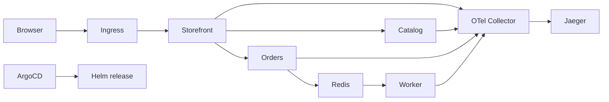

# Resilient Commerce

A portfolio monorepo in this empty workspace. The shop is only large enough to deploy, trace, break, and scale. The DevOps platform is the project.

Reviewers clone the repo and run one script on Linux. They do not need an AWS account. AWS is a separate, optional Terraform path with a cost warning (EKS control plane is billed even when idle).

## Progress

| Todo | Status | Notes |
|------|--------|-------|
| python-services | done | `apps/{storefront,catalog,orders,worker}` with tests, Dockerfiles, health, OTEL |
| helm-kind | in-progress | Umbrella Helm chart + subcharts present; kind config + bootstrap/teardown scripts still missing |
| observability-gitops | pending | `deploy/gitops` not present |
| demos-ci | pending | No `scripts/`, Makefile, or `.github/workflows` yet |
| terraform-docs | in-progress | `infra/terraform` (vpc, eks, ecr, envs/prod) + `docs/aws.md`; README/architecture/demo docs still open |

### Progress log

- Restored from Cursor plan `resilient_commerce_platform_4306ba23` (was mid-build; original todo `python-services` was `in_progress`).
- Repo audit: Python apps + Helm shop chart already on disk; GitOps, scripts, CI, Terraform, docs still open.
- Added optional AWS Terraform under `infra/terraform` (VPC, EKS, ECR, `envs/prod`) and `docs/aws.md`.

## What a reviewer can show in five minutes

- Delete a catalog pod and watch the ReplicaSet replace it (probes plus restart).
- Edit a live replica count and watch Argo CD `selfHeal` revert the drift.
- Send load and watch the storefront HorizontalPodAutoscaler add pods.
- Open one request in Jaeger: storefront to catalog, and storefront to orders to Redis to worker.

## Architecture

Self-healing is four layers, each visible in the repo:

- Container: liveness and readiness probes restart a bad process.
- Pod: at least two replicas, a PodDisruptionBudget, and a ReplicaSet replace deleted pods.
- Workload: HPA on CPU for storefront and catalog (metrics-server).
- Desired state: Argo CD `selfHeal: true` undoes manual drift.
- Nodes stay documented for AWS only: managed node group plus Cluster Autoscaler IAM. Kind cannot show node scale-up.

## Application

Four small Python 3.12 services. FastAPI for the HTTP ones. No accounts, payments, or database product. In-memory catalog data. Redis is the only extra component, so orders survive across the API and the worker without a multi-replica database problem.

- [apps/storefront](../apps/storefront) — one page: list products, place an order. Calls catalog and orders.
- [apps/catalog](../apps/catalog) — `GET /products`. Fixed seed catalog.
- [apps/orders](../apps/orders) — `POST /orders` pushes a job to Redis. `GET /orders` reads status keys.
- [apps/worker](../apps/worker) — blocks on the Redis list, marks the order fulfilled, records a span.

Each HTTP service exposes `/healthz` and `/readyz`. Each service sends OTLP traces to the collector. There is no Prometheus client and no `/metrics` scrape endpoint. Pytest covers health and the order handoff with a fake Redis. Ruff lints. Dockerfiles are multi-stage, non-root, and small.

## Local platform

[scripts/bootstrap.sh](../scripts/bootstrap.sh) is the Linux entrypoint. It creates a kind cluster (ingress ports 80/443, enough memory noted in the README), builds the four images, loads them into kind, installs ingress-nginx and Argo CD, and applies the root GitOps app. [scripts/teardown.sh](../scripts/teardown.sh) deletes the cluster. [scripts/demo-heal.sh](../scripts/demo-heal.sh) and [scripts/demo-scale.sh](../scripts/demo-scale.sh) run the two live demos. A [Makefile](../Makefile) only forwards to those scripts.

Kind images use `imagePullPolicy: Never` so the demo works before any registry exists.

Helm layout:

- [deploy/helm/shop](../deploy/helm/shop) umbrella chart with subcharts for storefront, catalog, orders, worker, and Redis.
- [deploy/helm/shop/values.yaml](../deploy/helm/shop/values.yaml) and [deploy/helm/shop/values-local.yaml](../deploy/helm/shop/values-local.yaml).
- Deployments, ClusterIP Services, Ingress, probes, requests and limits, PDB, HPA, and default-deny NetworkPolicies. Storefront may call catalog, orders, and the collector. Orders may call Redis. The worker may call Redis and the collector. Nothing else is allowed east-west.

GitOps layout under [deploy/gitops](../deploy/gitops):

- Argo CD app-of-apps.
- Shop Application points at the Helm chart and `values-local.yaml`, with automated sync, prune, and self-heal.
- Observability Application installs Jaeger and an OpenTelemetry Collector. Prometheus and Grafana are out.

Observability:

- Apps export traces only, over OTLP, to the collector.
- The collector exports those traces to Jaeger. Ingress exposes the Jaeger UI.
- Pod restarts and replica counts are shown with `kubectl` during the heal and scale demos. HPA still uses metrics-server CPU, which is separate from Prometheus.
- Skipping kube-prometheus-stack keeps the kind cluster smaller.

## GitHub Actions

Workflows are ready for the day the repo is on GitHub. They use GitHub Container Registry, not ECR, so the local demo stays free.

- [.github/workflows/ci.yml](../.github/workflows/ci.yml) on pull requests: ruff, pytest, `helm lint`, `terraform fmt -check`, `terraform init -backend=false` and `terraform validate`, and a Docker build with no push.
- [.github/workflows/release.yml](../.github/workflows/release.yml) on main, only when app or Docker files change: push the four images to GHCR tagged with the git SHA, then commit the new tags into the Helm values. Path filters stop that commit from building images again.

## AWS, optional

[infra/terraform](../infra/terraform) is not applied by bootstrap and is not required for the demo.

- [infra/terraform/modules/vpc](../infra/terraform/modules/vpc) — two AZs, public and private subnets, one NAT gateway, internet gateway, route tables. The README states that a second NAT is the production variant and this one is the cost compromise.
- [infra/terraform/modules/eks](../infra/terraform/modules/eks) — EKS, one managed node group, IRSA for Cluster Autoscaler.
- [infra/terraform/modules/ecr](../infra/terraform/modules/ecr) — four repositories.
- [infra/terraform/envs/prod](../infra/terraform/envs/prod) wires the modules. Backend stays local so CI can validate with no AWS credentials. [docs/aws.md](../docs/aws.md) explains S3 state, apply order, and the monthly cost.

Azure is out of scope.

## GitHub-ready docs

- [README.md](../README.md) — what it is, architecture diagram, one-command start, five-minute demo, and a skill map that points each resume item at a path: git layout, bash scripts, Python apps, GitHub Actions, Dockerfiles, Kubernetes and Helm manifests, Terraform, the VPC and NetworkPolicies, OpenTelemetry plus Jaeger, Argo CD. Prometheus and Grafana are not part of this project.
- [docs/architecture.md](../docs/architecture.md) — request path, healing layers, and why Redis replaces a database.
- [docs/demo.md](../docs/demo.md) — exact commands and what “good” looks like.
- [.gitignore](../.gitignore) for Python, Terraform, and kind.

No commit unless you ask for one. After the scaffold is in place, the first commit and a public GitHub repo are a separate step. The README will tell you to create the GitHub repo and enable GHCR so the release workflow has somewhere to push.

## Remaining work (resume here)

1. **helm-kind** — finish kind cluster config + `scripts/bootstrap.sh` / `scripts/teardown.sh` (Helm chart already largely present).
2. **observability-gitops** — Jaeger, OTel Collector, Argo CD app-of-apps with self-heal under `deploy/gitops`.
3. **demos-ci** — `demo-heal.sh`, `demo-scale.sh`, Makefile, GitHub Actions CI + GHCR release.
4. **terraform-docs** — optional AWS Terraform + README / architecture / demo / aws docs.
