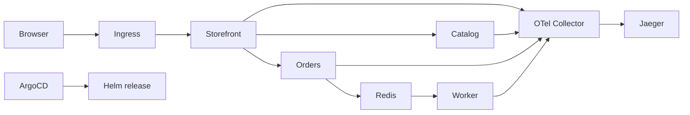

# Resilient Commerce

A portfolio monorepo. The shop is only large enough to deploy, trace, break, and scale. The DevOps platform is the project.

## Progress

| Todo | Status | Notes |
|------|--------|-------|
| python-services | done | Four apps with tests, Dockerfiles, health, OTEL |
| helm-kind | done | Helm umbrella + `deploy/kind/cluster.yaml` + bootstrap/teardown |
| observability-gitops | done | `deploy/observability` + `deploy/gitops` (Argo selfHeal) |
| demos-ci | done | demo scripts, Makefile, CI + release workflows |
| terraform-docs | done | `infra/terraform` + README + docs |

### Progress log

- Restored from Cursor plan `resilient_commerce_platform_4306ba23`.
- Completed remaining scaffold: kind, scripts, observability, GitOps, demos, Actions, Terraform, docs.
- Bootstrap installs shop via Helm immediately; set `GIT_REPO_URL` for Argo CD git sync / selfHeal demo.

## Remaining (optional follow-ups)

- Create GitHub remote, enable GHCR, set `GIT_REPO_URL`, run `./scripts/bootstrap.sh` on Linux/WSL.
- First git commit when you ask for one.
- Live verify demos on kind (not run in this Windows agent session).

## What a reviewer can show in five minutes

- Delete a catalog pod and watch the ReplicaSet replace it (probes plus restart).
- Edit a live replica count and watch Argo CD `selfHeal` revert the drift (requires `GIT_REPO_URL`).
- Send load and watch the storefront HorizontalPodAutoscaler add pods.
- Open one request in Jaeger: storefront to catalog, and storefront to orders to Redis to worker.

## Architecture

## Application

- [apps/storefront](../apps/storefront) — Next.js storefront: list products, place an order. Calls catalog and orders.
- [apps/catalog](../apps/catalog) — `GET /products`. Fixed seed catalog.
- [apps/orders](../apps/orders) — `POST /orders` pushes a job to Redis. `GET /orders` reads status keys.
- [apps/worker](../apps/worker) — blocks on the Redis list, marks the order fulfilled, records a span.

## Local platform

- [scripts/bootstrap.sh](../scripts/bootstrap.sh) / [teardown.sh](../scripts/teardown.sh)
- [scripts/demo-heal.sh](../scripts/demo-heal.sh) / [demo-scale.sh](../scripts/demo-scale.sh)
- [deploy/kind/cluster.yaml](../deploy/kind/cluster.yaml)
- [deploy/helm/shop](../deploy/helm/shop)
- [deploy/gitops](../deploy/gitops)
- [deploy/observability](../deploy/observability)

## GitHub Actions

- [.github/workflows/ci.yml](../.github/workflows/ci.yml)
- [.github/workflows/release.yml](../.github/workflows/release.yml)

## AWS, optional

- [infra/terraform](../infra/terraform)
- [docs/aws.md](../docs/aws.md)

## Docs

- [README.md](../README.md)
- [docs/architecture.md](../docs/architecture.md)
- [docs/demo.md](../docs/demo.md)
